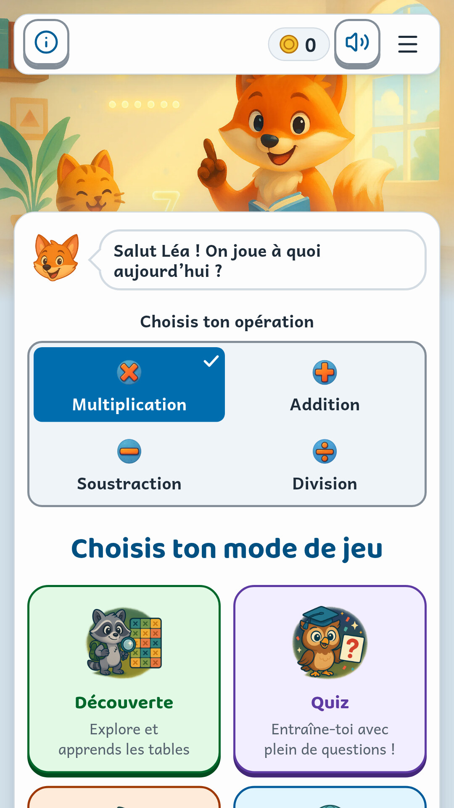
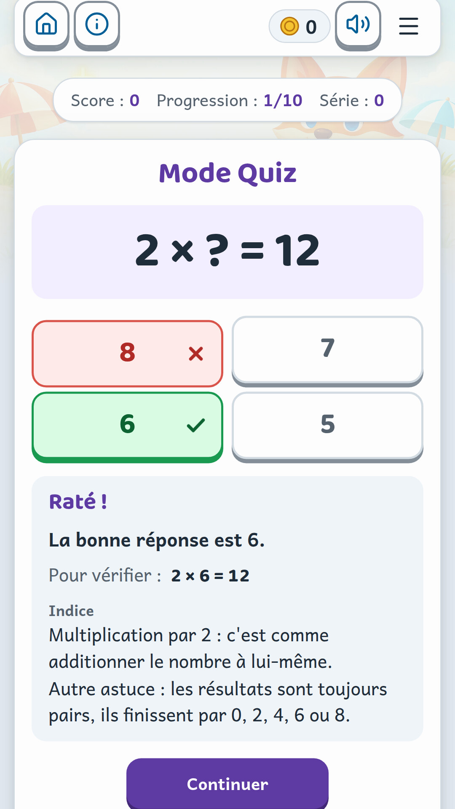
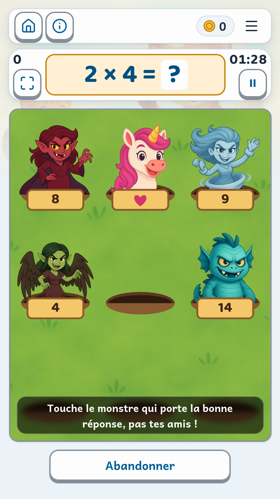
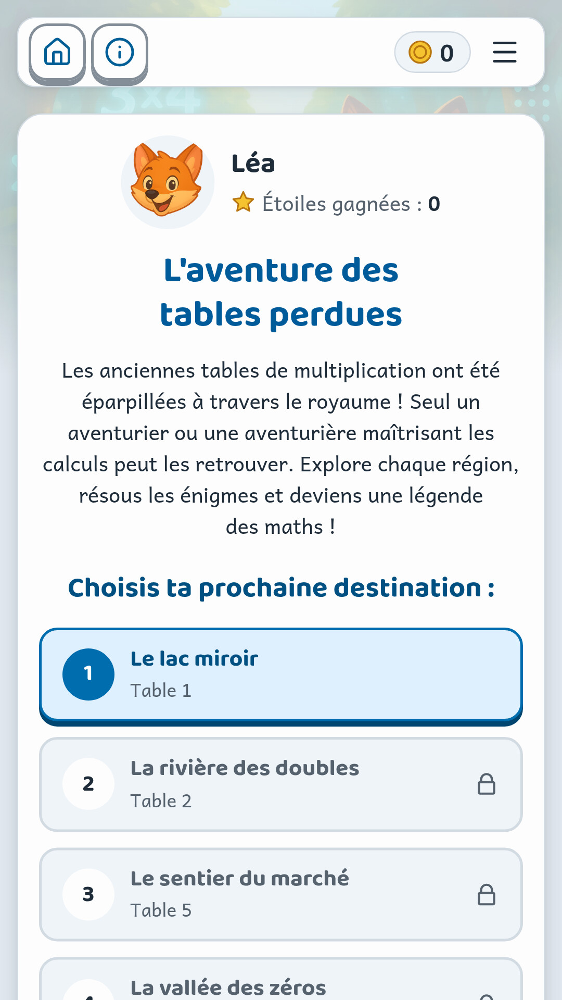
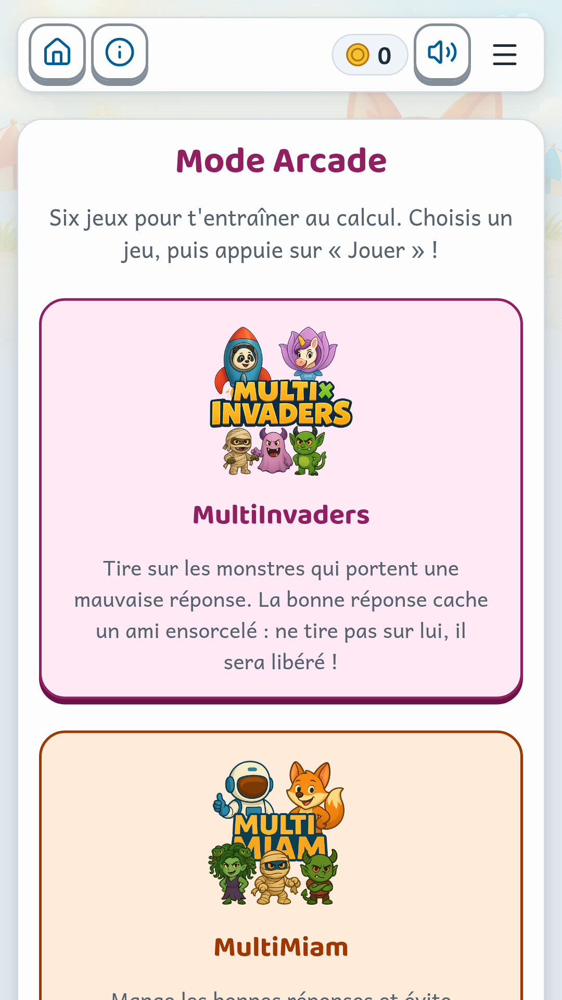
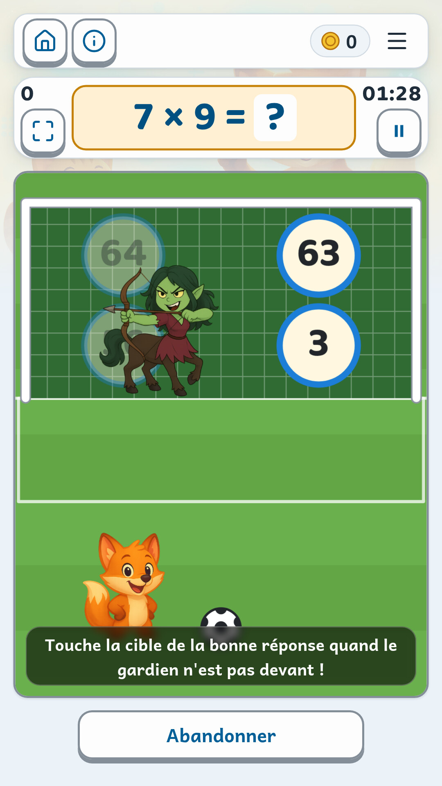
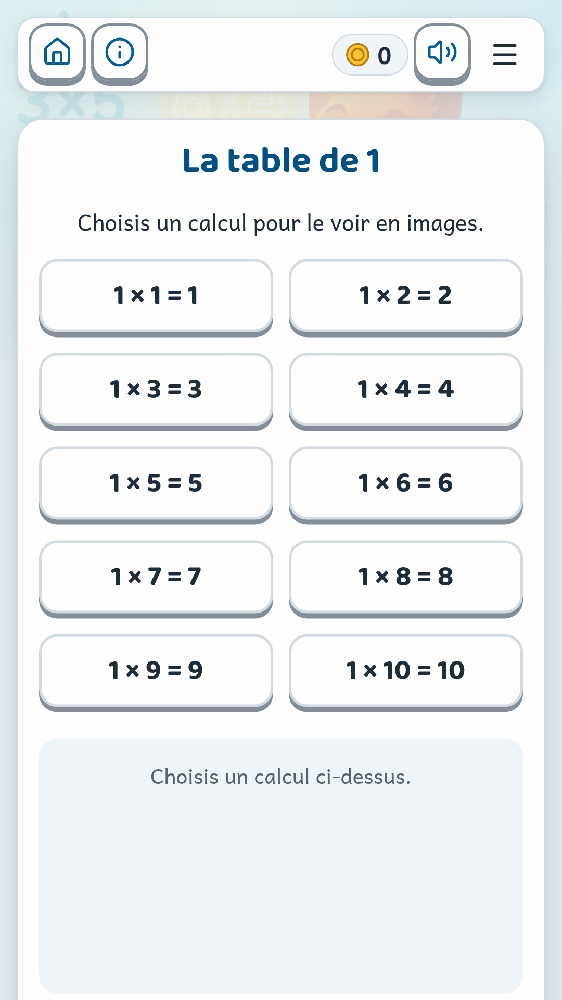
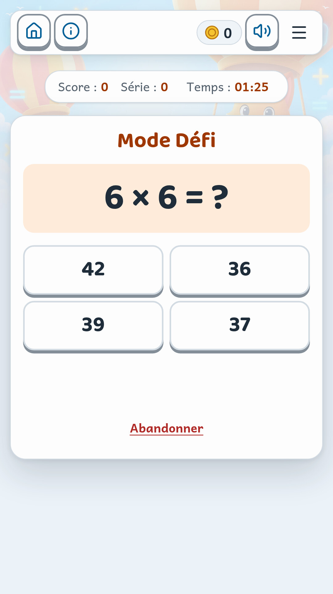

# LeapMultix pour Android

Le jeu web [LeapMultix](https://github.com/jls42/leapmultix) emballé par Capacitor dans une
appli Android (`org.jls42.leapmultix`). Ce dépôt se clone à côté de celui du jeu
(`LEAPMULTIX_REPO` sinon). La publication sur Google Play est en cours (test fermé) ; le lien
de la fiche sera ajouté ici à l'ouverture au public. En attendant, le même jeu se joue dans un
navigateur : [leapmultix.jls42.org](https://leapmultix.jls42.org).

Licence : [AGPL-3.0-or-later](LICENSE), comme le jeu.

## Aperçu

<p align="center">
  
  
  
  
</p>
<p align="center">
  
  
  
  
</p>

Ce sont les captures de la fiche Google Play, prises sur le contenu de l'appli. Elles existent
en français, en anglais et en espagnol, pour téléphone et pour tablettes de 7 et 10 pouces :
[`store/fiche/captures/`](store/fiche/captures). Les textes de la fiche sont à côté, par
langue : [`store/fiche/`](store/fiche).

## Refaire l'appli

```bash
scripts/build-aab.sh main     # site de la branche donnée, packs, AAB, APK du téléphone, installation
SKIP_SITE=1 scripts/build-aab.sh   # même chose sans refaire www/ ni les packs
DEVICE=<id> scripts/build-aab.sh   # un autre téléphone que le premier de « adb devices »
```

Étapes du script :

1. `scripts/bundle-www.sh <branche>` : `www/`, le site de la branche (`git archive`), sans les
   sources PNG en haute définition, avec les variantes WebP des images de cette branche
   (`scripts/copy-images.py` : celles d'images retirées du jeu, que le dossier de travail garde,
   n'entrent pas dans l'appli), sans les images d'une fête lointaine, et avec la voix
   enregistrée en Opus (« Une appli plus légère que le site », plus bas).
2. `npx cap sync android` : copie `www/` dans l'appli.
3. `scripts/pack-assets.sh` : déplace les images et la voix dans deux packs d'éléments livrés
   à l'installation (`images_pack`, `voix_pack`, Play Asset Delivery).
4. `./gradlew --no-daemon bundleDebug` : l'AAB de débogage.
5. bundletool 1.18.3 : les APK du téléphone tirés de l'AAB, comme le ferait le Play Store,
   signés par la clé de débogage standard (`~/.config/.android/debug.keystore`), leur taille,
   puis leur installation par-dessus l'appli en place. **Jamais de désinstallation** : elle
   effacerait les profils des joueurs.

## Une appli plus légère que le site

L'appli embarque tout le jeu pour jouer sans réseau. Deux choix de `scripts/bundle-www.sh`
l'allègent, sans rien changer au site :

- **La voix enregistrée est en Opus.** Le site sert ses clips en MP3, que tous les navigateurs
  lisent ; l'appli n'a qu'un lecteur, celui d'Android, qui lit l'Opus. Les mêmes clips,
  convertis à 24 kb/s, pèsent près de trois fois moins. Ils se préparent une fois dans le dépôt
  des voix, depuis le dépôt du jeu (`node scripts/voice/opus.mjs --out <dépôt des voix>`), et
  après chaque nouvelle phrase enregistrée. La construction ne convertit rien : elle prend les
  clips prêts, et s'arrête si l'un manque ou a changé (`scripts/check-voice-clips.py` compare
  ensuite le site embarqué au manifeste des clips).
- **Une fête lointaine n'est pas embarquée.** Les images de chaque fête (personnages costumés,
  fonds, logos) pèsent une soixantaine de Mo. `scripts/drop-seasons.mjs` retire celles des
  fêtes de la liste `FETES_ABSENTES` (« halloween » sans elle) et écrit dans `index.html`
  quelles fêtes manquent : le jeu ne demande alors aucune de leurs images, et garde ses
  couleurs et ses dessins ordinaires si l'appli n'a pas été mise à jour à temps.
  - **Pour ne pas l'oublier** : une fête de la liste qui est en cours, ou qui commence dans
    183 jours au plus, est embarquée quand même, et le journal de la construction le dit.
    Halloween (24 octobre) manque donc à une appli construite avant le 24 avril, et revient
    de lui-même dans toute appli construite ensuite.
  - `FETES_ABSENTES=halloween,lunarnewyear scripts/build-aab.sh main` retire deux fêtes ;
    `FETES_ABSENTES= scripts/build-aab.sh main` (liste vide) les embarque toutes. Les
    identifiants sont ceux de `js/core/seasons.js` du jeu ; un identifiant inconnu arrête la
    construction.
  - Publier une version de l'appli dans les six mois qui précèdent une fête suffit à la
    faire revenir chez les joueurs.

## Construire sans la voix enregistrée

Les clips de la voix enregistrée viennent d'un dépôt privé, cherché à côté de celui du jeu
(`../leapmultix-voices`, ou `LEAPMULTIX_VOICES`). Sans lui, la construction s'arrête et le dit.
Pour construire quand même l'appli, sans voix enregistrée :

```bash
SANS_VOIX=1 scripts/build-aab.sh main
```

- C'est un choix à dire, jamais deviné : un dépôt des voix introuvable ne produit pas en silence
  une appli sans voix.
- Le pack de voix existe toujours (il est déclaré dans le build), avec une simple note à la place
  des clips, qui pèsent environ 190 Mo dans l'appli complète (489 Mo quand ils étaient en MP3).
- Dans cette appli, le jeu lit avec la synthèse vocale du téléphone (plugin `LeapMultixSpeech`,
  ci-dessous) : la page de l'appli n'a pas celle d'un navigateur.
- `scripts/build-release.sh` refuse `SANS_VOIX=1`, et vérifie dans l'AAB produit que chacune des
  trois langues a tous ses clips, en Opus, sans un seul MP3 : une appli publiée embarque
  toujours la voix enregistrée.

## Publier sur le Play Store

```bash
scripts/build-release.sh main            # AAB de publication signé, contrôlé, prêt à envoyer
REVISION=1 scripts/build-release.sh main # seconde publication d'un même site
```

- **Numéro de version** tiré du site embarqué : v92 donne `versionCode` 9200 et `versionName`
  v92 (v92.1 pour `REVISION=1`). Le Play Store refuse un numéro déjà envoyé, même d'une version
  retirée.
- **Clé d'envoi**, une fois pour toutes, par le propriétaire dans son propre terminal, hors du
  dépôt, sauvegardée, mots de passe dans un gestionnaire :
  `keytool -genkeypair -v -keystore ~/leapmultix-upload.jks -alias upload -keyalg RSA -keysize 2048 -validity 10000`.
  Puis quatre lignes dans `~/.gradle/gradle.properties`, jamais dans le dépôt :
  `leapmultixUploadStoreFile` (chemin absolu du `.jks`), `leapmultixUploadStorePassword`,
  `leapmultixUploadKeyAlias` (`upload`), `leapmultixUploadKeyPassword`. Le script ne les lit
  pas : seul Gradle s'en sert.
- **Contrôles** du script : numéro attendu, appli non débogable, signature présente et qui n'est
  pas la clé de débogage (sinon il échoue, et « AAB NON SIGNÉ » sans clé), taille des modules.
- **Contenu** (`scripts/check-bundle.sh <fichier .aab>`, lancé par les deux scripts de
  construction) : le jeu et rien d'autre. Refusés : un type de fichier inattendu dans le site
  embarqué, un fichier caché ou de travail (`.env`, `.md`, scripts, tests, cartes de sources),
  un chemin du poste de construction, une clé ou un jeton, une adresse e-mail autre que celle
  du contact, une trace du dépôt, une image d'une fête que le site embarqué dit absente. Tout
  ce qui n'est ni son, ni image, ni vidéo, ni police est
  lu, code compilé compris. Un build de débogage garde les chemins de ses ressources :
  `--debug` les tolère, et lui seul.
- **Envoi** : Play Console, Test fermé, nouvelle version, l'AAB de
  `android/app/build/outputs/bundle/release/`. Google re-signe l'appli avec sa propre clé.
- **Un téléphone qui porte l'appli de débogage** ne peut pas recevoir celle du Play Store
  par-dessus : elle est signée par une autre clé, et la désinstallation effacerait les profils.
  Y tester depuis le Play Store suppose d'accepter cette perte ; sinon, un autre téléphone.

## Outils

- **JDK 21** du système (`/usr/lib/jvm/java-21-openjdk-amd64`), Capacitor 8 compilant en
  Java 21.
- **SDK Android** dans `~/Android/Sdk` : `android/local.properties` (non versionné) contient
  `sdk.dir=/home/<utilisateur>/Android/Sdk`.
- **bundletool** dans `~/Android/bundletool/bundletool-all-1.18.3.jar`.
- Gradle en `--no-daemon` : le démon disparaissait en pleine construction.

## Réglages

- **Capacitor 8.6.2**, Android Gradle Plugin 8.13, Gradle 8.14.3, `compileSdk` et `targetSdk`
  36, `minSdk` 24.
- **Packs d'éléments** livrés à l'installation (`assetPacks` dans `android/app/build.gradle`) :
  le module de base reste sous la limite de 500 Mo compressés du Play Store, 4 Go en tout par
  appareil.
- **Barres d'Android cachées** (plugin System Bars, zones sûres gérées en natif) ; le site
  garde la page hors de l'encoche de la caméra.
- **Plein écran des jeux d'Arcade** : le client de Capacitor refusait la demande de la page (API
  Fullscreen) ; celui de `MainActivity` pose la vue plein écran par-dessus tout, et le bouton
  retour en sort d'abord.
- **Bouton retour** : hors plein écran, `MainActivity` demande au jeu de revenir à l'écran
  précédent (événement `backbutton` envoyé à la page, que le jeu annule quand il a reculé :
  `js/back-navigation.js`). Sur le premier écran, pendant l'image de bienvenue ou sans réponse
  du jeu en une seconde, l'appli se ferme comme avant : le bouton ne reste jamais sans effet.
- **Portrait et paysage** : aucune orientation imposée (`AndroidManifest.xml`) ; le site a une
  mise en page pour le téléphone tourné, et une rotation ne recharge pas la partie
  (`configChanges`). L'appli reste déclarée « jeu ».
- **Invite de mise à jour** (`UpdatePrompt`) : au lancement, une fois le jeu affiché, l'appli
  demande au Play Store du téléphone si une version plus récente existe (bibliothèque de Google
  Play `app-update`, mise à jour souple). Google Play affiche alors sa propre fenêtre, dans la
  langue du téléphone ; acceptée, la mise à jour se télécharge pendant le jeu et s'installe au
  lancement suivant, jamais pendant une partie ; refusée, la même version n'est reproposée
  qu'après trois jours. Sans Play Store (appli d'essai), rien ne s'affiche. L'invite ne se
  prouve que sur une appli installée depuis Google Play, avec une version plus récente publiée.
- **Voix enregistrée** embarquée dans le pack voix, servie sous `/voice/` comme sur le site,
  mais en Opus (fichiers `.ogg`) : l'index des voix du site embarqué annonce ce format, et le
  jeu demande alors les clips sous ce nom.
- **Plausible** : aucune mesure dans l'appli. `bundle-www.sh` retire d'`index.html` les blocs qui
  la lancent, puis le traceur lui-même (`js/plausible-init.js`, `js/vendor/plausible.js`) et ses
  deux lignes de la liste hors ligne ; `check-bundle.sh` refuse un build où il reviendrait.
- **Textes propres à l'appli** (`scripts/app-texts.py`, appelé par `bundle-www.sh`) : l'écran
  « Politique de confidentialité » montre la politique de l'appli (`confidentialite-android.html`
  du site, la même que sur la fiche Google Play), les mentions légales disent qu'elles décrivent
  le site, et les textes qui parlent du site décrivent l'appli, en fr, en et es (questions
  fréquentes : hors ligne, écrans, données, voix ; voix d'« À propos » ; note de confidentialité
  de l'accueil). Les données pour moteurs de recherche (JSON-LD) partent. Le script échoue si un
  texte attendu ne se trouve plus dans le site, ou si une phrase du site reste dans la page.
- **« Sauvegarde des joueurs »** : la WebView ne télécharge rien, alors le site confie le
  fichier à l'appli (plugin `LeapMultixFiles`, `FilesPlugin.java`), qui ouvre la fenêtre
  « Enregistrer sous » d'Android et écrit dans le fichier choisi, sans autorisation à demander.
  La reprise d'un fichier passe par le sélecteur de fichiers de Capacitor. Avec un site d'avant
  ce plugin, la section est cachée (même script) : le bouton n'y ferait rien. Les profils sont
  aussi gardés par la sauvegarde d'Android (`allowBackup`, dite dans la politique de l'appli).
- **Voix du téléphone** (plugin `LeapMultixSpeech`, `SpeechPlugin.java`) : la page de l'appli
  n'a pas la synthèse vocale d'un navigateur, alors la « voix de l'appareil » du jeu est ici la
  synthèse vocale d'Android. Le jeu s'en sert quand le joueur décoche « Voix enregistrée », ou
  dans une appli construite sans elle. Une phrase à la fois, chaque appel reçoit une réponse
  (finie, coupée, ou refusée quand la langue manque au téléphone). Le manifeste déclare le
  service vocal (`<queries>`), sans autorisation à demander. Avec un site d'avant ce plugin,
  les textes de l'appli ne promettent pas cette voix (`scripts/app-texts.py`).
- **Adresse de l'appli fixée** (`server` dans `capacitor.config.json` : `https://localhost`) : les
  profils des joueurs sont rangés par adresse ; une autre adresse, et ils sembleraient perdus.
  Ne jamais la changer, y compris lors d'une migration de Capacitor.
- **Aucune clé** dans le dépôt : `*.keystore`, `*.jks`, `local.properties`, `www/`, les APK et
  les AAB sont ignorés.
